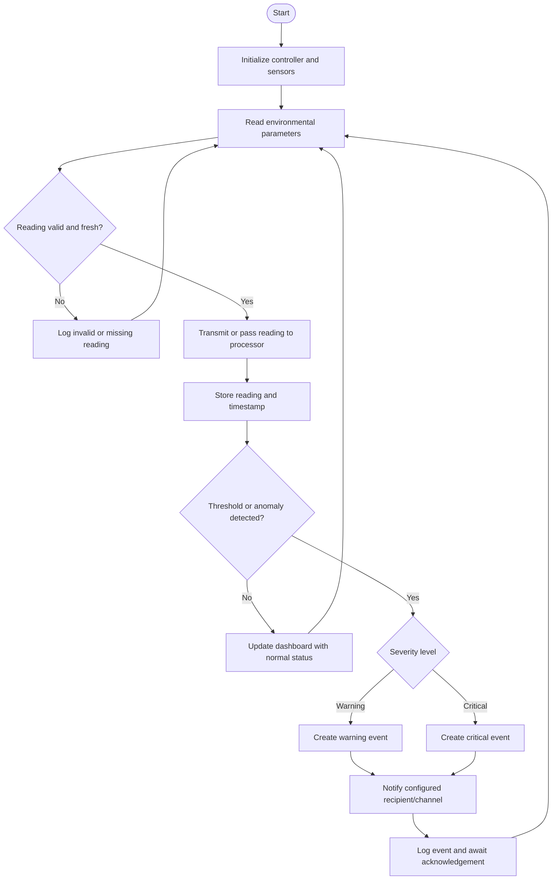
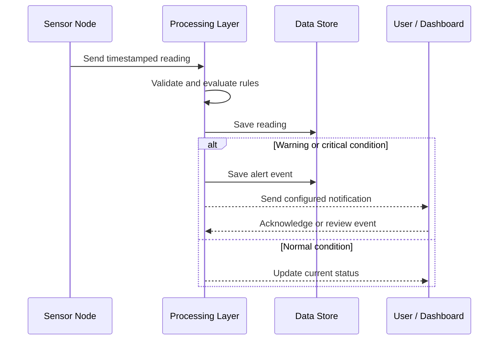

# EcoShield — Environmental Anomaly & Disaster Alert Framework

> **A proposed IoT-enabled framework for monitoring environmental conditions, detecting abnormal readings, and distributing timely alerts to support disaster preparedness.**


## Table of Contents
- [Overview](#overview)
- [Problem Statement](#problem-statement)
- [Objectives](#objectives)
- [Key Features](#key-features)
- [System Architecture](#system-architecture)
- [Working Flow](#working-flow)
- [Flowchart](#flowchart)
- [Hardware and Software](#hardware-and-software)
- [Data Flow and Anomaly Detection](#data-flow-and-anomaly-detection)
- [Dashboard and Visualizations](#dashboard-and-visualizations)
- [Example Graph](#example-graph)
- [Alert Workflow](#alert-workflow)
- [Repository Structure](#repository-structure)
- [Setup and Run](#setup-and-run)
- [Configuration](#configuration)
- [Testing and Validation](#testing-and-validation)
- [Safety, Limitations, and Future Scope](#safety-limitations-and-future-scope)
- [Contributors](#contributors)

## Overview

**EcoShield** is an environmental monitoring and disaster-alert project concept. It brings together sensor-based data collection, data processing, anomaly detection, visualization, and alert delivery in one workflow. The framework is intended to help identify unusual environmental conditions—such as rapid changes in temperature, humidity, water level, air quality, or rainfall—so that a responsible person can investigate and respond.

The exact sensors, controller, cloud platform, notification channel, and detection rules depend on the hardware and software actually implemented in your project. Sections below provide a detailed, adaptable project README. Replace example components and setup commands with the ones used in your build before publishing.

## Problem Statement

Environmental hazards can develop quickly, while manual observation may be intermittent or geographically limited. A monitoring system can collect readings continuously and flag conditions that cross configured limits. EcoShield aims to organize this process into a clear pipeline: **sense → transmit → validate → analyze → visualize → alert**.

## Objectives

1. Collect environmental readings using suitable sensors.
2. Transfer readings from the sensor node to a processing layer.
3. Validate readings and handle missing, invalid, or stale data.
4. Detect threshold violations or unusual changes.
5. Present current readings and historical trends in a dashboard.
6. Generate alerts that include the parameter, reading, threshold, time, and location/device identifier.
7. Maintain a record of readings and alert events for review.
8. Provide a modular design so additional sensors or alert channels can be integrated.

## Key Features

- **Environmental sensing:** supports parameters for which compatible sensors are installed.
- **Anomaly rules:** configurable thresholds and optional rate-of-change checks.
- **Real-time or periodic updates:** depends on the connectivity and sampling interval used.
- **Visual monitoring:** current values, time-series trends, and alert status.
- **Alert management:** warning/critical levels, event timestamps, and acknowledgement workflow.
- **Modular design:** sensor, communication, processing, storage, dashboard, and alert components can be changed independently.
- **Extensible:** can be adapted for flood-risk indicators, heat events, air-quality monitoring, or other environmental use cases.

## System Architecture


### Architecture layers

| Layer | Responsibility | Examples (choose only what you actually use) |
|---|---|---|
| Sensing | Measures environmental parameters | Temperature/humidity, water-level, rain, gas/air-quality sensors |
| Edge controller | Reads sensors and packages measurements | ESP32, Arduino, Raspberry Pi, or another controller |
| Communication | Sends readings to the next layer | Wi-Fi, cellular, LoRa, MQTT, HTTP, serial |
| Processing | Validates data and evaluates rules | Embedded logic, Python service, backend API |
| Storage | Stores readings and alert events | CSV, SQLite, SQL database, cloud database |
| Visualization | Displays status and trends | Web dashboard, local display, plotted reports |
| Notification | Communicates important events | Dashboard warning, email, SMS, app notification, buzzer |

The examples are options, not claims about the current implementation. Update this table to match the actual prototype.

## Working Flow

1. **Sense:** sensors capture readings at a configured interval.
2. **Read and package:** the controller obtains sensor values and attaches a timestamp/device ID where possible.
3. **Transmit:** readings are sent to the processing layer or retained locally if connectivity is unavailable.
4. **Validate:** the system checks whether readings are missing, outside the sensor's valid range, or too old.
5. **Analyze:** validated readings are compared with configured thresholds and/or change-rate rules.
6. **Classify:** the event is marked normal, warning, or critical according to project rules.
7. **Display and log:** readings and event history are shown and stored.
8. **Notify:** if an alert rule is met, the system issues a notification through the configured channel.
9. **Review:** a user checks the event and records acknowledgement or follow-up action.

## Flowchart



## Hardware and Software

Fill in the exact model numbers and tools used in your build.

### Hardware

| Component | Purpose | Actual part/model |
|---|---|---|
| Microcontroller / edge device | Sensor interfacing and local control | `Add your board` |
| Environmental sensors | Capture environmental parameters | `Add sensor models` |
| Connectivity module | Sends data where required | `Add module/network` |
| Power supply | Powers the node | `Add power specification` |
| Optional buzzer/display | Local indication | `Add if used` |

### Software and technologies

| Layer | Technology used |
|---|---|
| Firmware | `Add language / IDE` |
| Data transport | `Add protocol` |
| Backend / processing | `Add language / framework` |
| Database / storage | `Add database or file format` |
| Dashboard / visualization | `Add framework or plotting library` |
| Alerts | `Add actual notification channel` |
| Version control | Git and GitHub (if used) |

## Data Flow and Anomaly Detection

A reading can be represented as a record such as:

```json
{
  "device_id": "node-01",
  "timestamp": "2026-01-01T10:00:00Z",
  "parameter": "water_level",
  "value": 72.4,
  "unit": "cm",
  "status": "warning"
}
```

This is an **example schema only**. Use the units, names, and fields appropriate to your sensors.

### Basic threshold rule

For a parameter with a configured upper limit:

- Normal: reading is below the warning limit.
- Warning: reading reaches the warning limit.
- Critical: reading reaches the critical limit.

For parameters where lower values are dangerous, configure lower-bound rules instead. Some parameters need a range, persistence over several samples, or a rate-of-change rule rather than a single threshold.

```text
if reading is invalid or stale:
    mark as unavailable and log a data-quality event
else if reading crosses critical rule:
    status = CRITICAL
    create alert
else if reading crosses warning rule:
    status = WARNING
    create alert
else:
    status = NORMAL
```

Avoid sending repeated notifications for every sample. Consider a cooldown period, hysteresis, or a requirement that the condition persist for multiple samples. Thresholds should be chosen from sensor specifications and relevant local guidance—not from the illustrative values in this README.

## Dashboard and Visualizations

A useful dashboard may include:

- Latest reading for each sensor and its unit.
- Last-updated timestamp and device connectivity.
- Time-series line chart for each parameter.
- Threshold lines to show warning and critical limits.
- Alert list with severity, timestamp, parameter, and acknowledgement status.
- Data-quality indicator for missing, stale, or implausible readings.
- Filters for device, parameter, and date/time range.


## Example Graph

The chart above is **illustrative mock data only**, created to demonstrate how a sensor trend and warning threshold might be shown. It is not a measurement from EcoShield hardware and must not be presented as experimental results. Replace it with data collected during your tests.

If you have CSV data, a typical format is:

```csv
timestamp,temperature_c,humidity_percent,water_level_cm
2026-01-01T10:00:00,28.1,62,34
2026-01-01T10:05:00,28.4,61,35
```

## Alert Workflow



An alert should ideally include:
- **What:** parameter and measured value.
- **Where:** device ID or location, if available.
- **When:** timestamp and freshness of the reading.
- **Why:** rule/threshold that was triggered.
- **Severity:** warning or critical.
- **Next step:** a safe, predefined action or instruction to verify the condition.

## Repository Structure

A suggested structure (adapt it to the files that actually exist):

```text
EcoShield/
├── README.md
├── assets/
│   ├── ecoshield-banner.svg
│   ├── ecoshield-architecture.svg
│   └── ecoshield-example-chart.svg
├── firmware/          # microcontroller code, if applicable
├── backend/           # API or processing service, if applicable
├── dashboard/         # visualization UI, if applicable
├── data/              # sample/test data; do not commit private data
├── tests/             # validation and test scripts
└── docs/              # wiring diagrams, reports, and notes
```

Do not create empty folders just to match this diagram; document the folders that are really present in your repository.

## Setup and Run

Because the implementation details were not supplied, the commands below are a checklist rather than runnable project-specific commands.

1. Clone the repository:
   ```bash
   git clone <your-repository-url>
   cd EcoShield
   ```
2. Connect the sensors according to your verified circuit/wiring diagram.
3. Add required libraries and configure the board/IDE.
4. Set communication credentials and endpoint values in a local configuration file or environment variables.
5. Start the firmware, backend, or dashboard using the actual commands for your stack.
6. Confirm that incoming readings include valid timestamps and units.
7. Test a normal reading and a simulated threshold crossing before relying on notifications.

**Before publishing:** replace `<your-repository-url>`, add the actual install/run commands, and remove steps for components your project does not use.

## Configuration

Keep configuration separate from source code where possible. Typical settings include:

```text
SAMPLE_INTERVAL_SECONDS=<sampling interval>
WARNING_THRESHOLD=<verified warning threshold>
CRITICAL_THRESHOLD=<verified critical threshold>
DEVICE_ID=<unique device identifier>
```

These are placeholders, not valid values for a particular sensor. Do not commit Wi-Fi passwords, API keys, tokens, or personal contact details to GitHub. Use environment variables or a private local configuration file.

## Testing and Validation

Recommended test cases:

| Test | Expected behavior |
|---|---|
| Normal in-range reading | Status remains normal |
| Warning-boundary reading | Warning event is generated according to configured rule |
| Critical-boundary reading | Critical event is generated according to configured rule |
| Missing or malformed reading | Reading is rejected or marked invalid; system continues safely |
| Stale timestamp | Data is marked stale and not treated as current |
| Network outage | Local buffering/retry or explicit offline status, if implemented |
| Sensor disconnected | Fault is surfaced rather than silently reporting a normal value |
| Repeated threshold readings | Duplicate-alert handling follows the chosen cooldown/hysteresis rule |
| Recovery below threshold | Status returns to normal according to the recovery rule |

Record actual test date, setup, expected result, observed result, and evidence. Only report accuracy, response time, or reliability figures after measuring them.

## Safety, Limitations, and Future Scope

### Limitations
- Sensor accuracy and calibration affect the reliability of readings.
- Connectivity or power loss may delay data and notifications.
- A threshold alert is an indicator, not proof that a disaster will occur.
- The system may miss events outside sensor coverage or configured rules.
- A prototype should not replace official emergency-warning systems or professional assessment.

### Future scope
- Add more sensor nodes and a map-based device view.
- Use moving averages or rate-of-change detection to reduce false alarms.
- Add offline buffering and connectivity-health monitoring.
- Add role-based access, alert acknowledgement, and event export.
- Integrate weather or public environmental data where permitted.
- Evaluate anomaly-detection models against a labeled dataset, if sufficient data is available.
- Improve low-power operation, enclosure protection, and sensor calibration.
- Add multilingual notifications and accessibility improvements.

## Contributors

- **Project:** EcoShield — Environmental Anomaly & Disaster Alert Framework
- **Author / Team:** `Add contributor names`
- **Department / Institution:** `Add details`
- **Guide:** `Add guide name, if applicable`

## License

Choose a license that matches your institution/team's requirements (for example, MIT for an open-source software project). Do not claim a license until you add the corresponding `LICENSE` file.

---

**Project note:** This README intentionally distinguishes example architecture and mock visualizations from measured results. Update the hardware, technologies, thresholds, repository paths, and run instructions to match your actual implementation before submitting or publishing.
